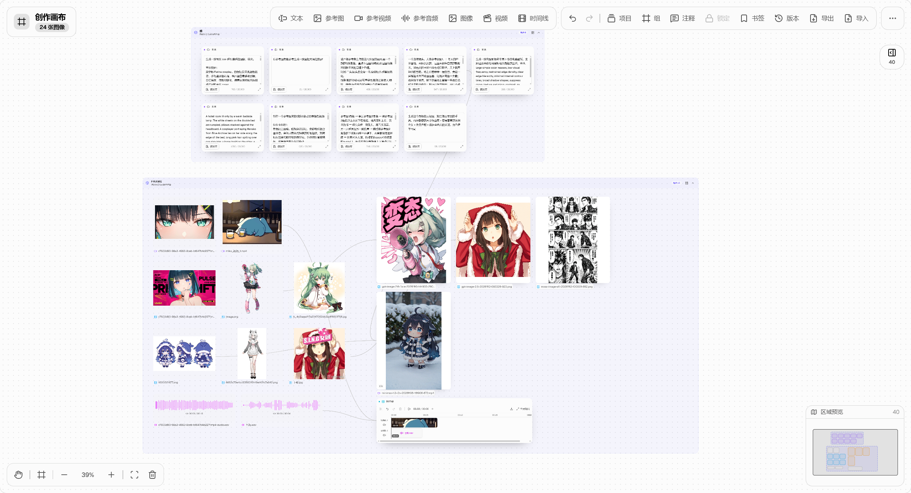
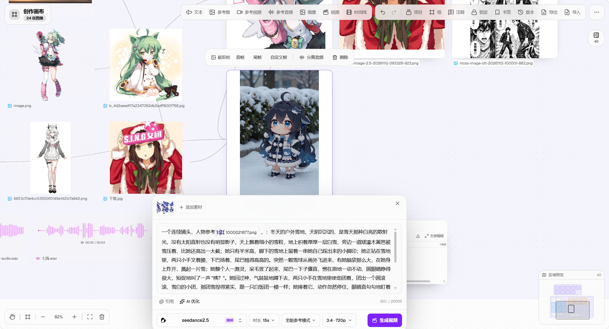
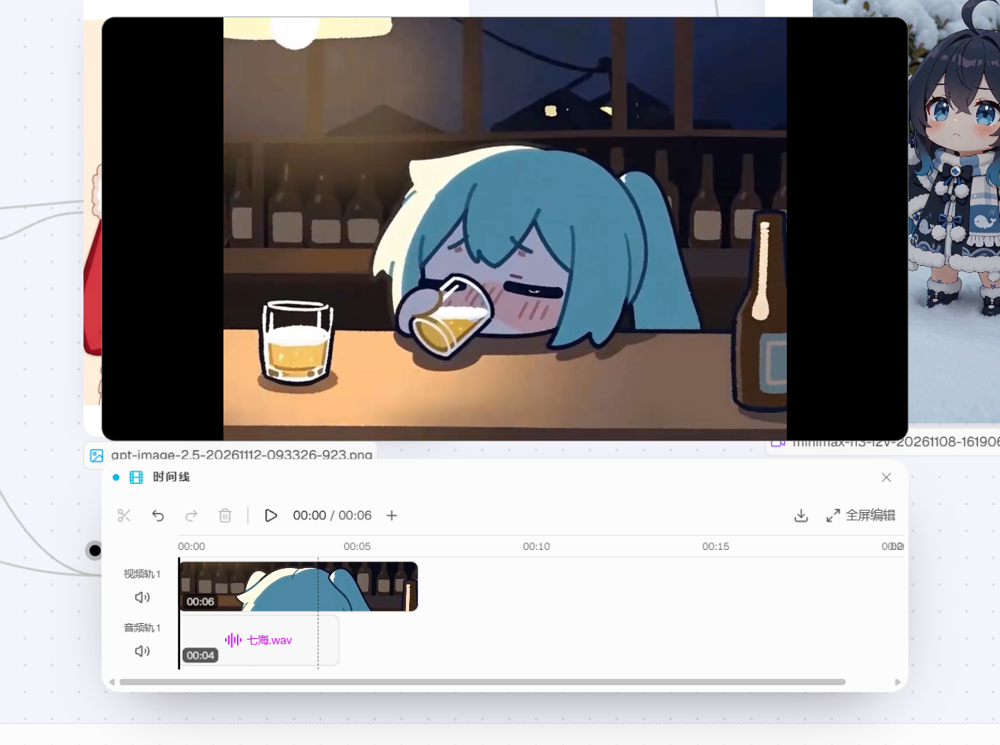

# 创作画布能力说明（2026-11 更新）

创作画布是 DEEIX Chat 内置的节点式创作工作台：把「提示词 / 参考素材 / 生成 / 剪辑 / 导出」拆成可连线的节点，在同一张无限画布上完成从灵感到成片的完整链路。

## 一、节点类型与连接

| 节点 | 作用 | 说明 |
| --- | --- | --- |
| 文本 | 存放提示词 | 可作为生成节点的提示词输入，也可独立整理 |
| 参考图 / 参考视频 / 参考音频 | 素材节点 | 支持本地上传与拖拽导入，展示类型图标 + 文件名的悬浮名称条，可双击改名 |
| 图像生成 | 文生图 / 图生图 / 局部重绘 / 扩图 / 裁剪 | 结果直接呈现在卡片内，点击打开参数面板与悬浮工具栏 |
| 视频生成 | 文生视频 / 图生视频 | 支持首尾帧参考、时长、分辨率与实时进度 |
| 时间线 | 多轨剪辑 | 接入视频/音频素材后按轨道剪辑、预览、导出 |
| 输出 | 生成产物 | 与其他节点连线后承载结果，可继续作为下游输入 |

连接点只出现在节点左右两侧：左侧输入、右侧输出，避免上下边缘误连；时间线的输出可以直接连到视频生成节点的视频输入。

## 二、生成与编辑

- **图像**：改图（局部重绘 / 扩图 / 裁剪）以画布内联选区完成，扩图选区可以超出原图并用斜线蒙版标注，支持四角与四边独立拉伸；编辑描述直接写入生成节点对话框，不再额外生成文本节点。
- **视频**：支持首尾帧与自定义帧截取，生成过程中展示流式预览帧与进度。
- **参数面板**：分辨率、画面比例（图示按真实比例绘制）、自定义宽高；输入框高度限制在 3~7 行，长提示词不会撑破面板。
- **请求协议**：图像生成与图像编辑固定走非流式上游，不会向上游传递 `stream=true`；视频生成保留流式进度。

## 三、画布交互与布局

- 拖动、框选合并在一个模式按钮里，点击切换，按住 `Ctrl` 临时切到另一种模式。
- 节点拖动带边缘/中线对齐吸附，命中时显示跨画布对齐参考线。
- 编组支持一键自动排版：素材类在左、生成类在右，同类型节点按两行均分横向铺排（3→3、4→2+2、5→3+2、7→4+3、9→5+4），排版后自动扩展组框包裹全部节点。
- 重置视图会定位到内容区域，而不是固定的原点。
- 支持撤销 / 重做、多选删除、复制副本，以及跨项目复制粘贴节点（`Ctrl/Cmd+C`、`Ctrl/Cmd+V`，通过本地剪贴板保留连线与素材引用）。
- 把文件直接拖进画布即可导入：图片生成参考图节点，视频/音频生成素材节点，多文件自动错开摆放。
- 右下角小地图与缩放控件，配合项目 / 分组 / 版本 / 导出 / 导入等画布级操作。

## 四、时间线剪辑

- 视频轨 + 音频轨双轨模型，支持自定义新增视频/音频轨道，轨道区可纵向滚动查看，轨道栏在横向滚动时吸附在左侧。
- 时间轴刻度、播放头、悬停线严格对齐鼠标（画布缩放时按内容比例换算），点击时间轴只做跳转，不会误分割。
- 分割：选中片段时只有分割线落在该片段内才允许分割；未选中时在所有轨道上按分割线位置切开，切点按时间线坐标精确换算到源素材秒数。
- 片段可自由拖动位置并跨同类型轨道移动，不产生重叠：落在其他片段前半段插入其前，落在后半段贴其尾部，后续片段自动后移。
- 预览：悬停/拖动即时预览对应画面，播放时节点自动提升层级，节点靠近画布顶部时预览面板自动翻到节点下方，避免被遮挡。
- 全屏编辑：左侧列出全部素材，「全部素材」项按时间线顺序连续播放成片，播放头与时间轴同步；退出全屏会停止播放并保留当前画面。
- 素材操作：截取帧（首帧 / 尾帧 / 自定义帧，自定义面板带缩略时间线与可拖动播放头）、分离音频、下载。
- 导出：后端 ffmpeg 按时间线顺序裁剪拼接视频，并把音频轨按 `atrim → adelay → amix → apad` 混入成片，导出的视频素材带声音。

## 五、截图演示

### 1. 画布总览：编组、素材节点与生成结果并存

### 2. 素材悬浮工具栏与提示词对话框

选中素材后浮出工具栏（截取帧 / 首帧 / 尾帧 / 自定义帧 / 分离音频 / 下载），并可直接在底部完成模型、时长、分辨率等参数设置后开始生成。

### 3. 时间线节点：双轨剪辑、预览与全屏编辑

播放时在节点上方浮出无窗口预览，下方为视频轨 / 音频轨与播放头，工具栏支持分割、撤销/重做、删除、播放与全屏编辑。

## 六、已知限制

- 画布内播放与导出以「第一条视频轨 + 音频轨」为准，自定义的额外轨道用于素材整理与剪辑，暂不参与成片合成。
- 导出按时间线顺序拼接，片段之间的空白间隙会被压缩掉；音频轨按时间线起点延时混音。
- 生成产物需要保存到平台文件后才可导出为时间线素材；保存失败时节点提供重试入口。
